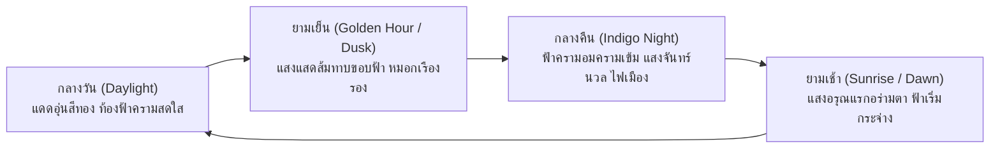

# PhaiCity "Go Inter": World-Class Architecture & Roadmap
**แผนยุทธศาสตร์ยกระดับ PhaiCity สู่เกมสร้างเมืองมาตรฐานสากลระดับโลก (World-Class Standard)**  
*บันทึกเมื่อ: 17 ตุลาคม 2026*

---

## 1. บทสรุปผู้บริหารและวิสัยทัศน์ (Vision & Executive Summary)

เกมสร้างเมืองบนตลาดโลกในปัจจุบัน (เช่น *Cities: Skylines*, *SimCity*, *TheoTown*, *Workers & Resources*) เกือบทั้งหมดจำลองบริบทของเมืองตะวันตก (อเมริกา/ยุโรป) หรือญี่ปุ่น โดยยังไม่มีเกมใดในโลกที่นำเสนอ **"เมืองไทยร่วมสมัย (Contemporary Thailand)"** ในระดับกราฟิก 3D สเกลเมตริก 1:1 อย่างสมบูรณ์

**PhaiCity (ไผ่ซิตี้)** มีจุดแข็งที่พร้อม "Go Inter" ทันที:
1. **Simulation แกนลึก:** ดัดแปลงและต่อยอดจาก Micropolis / SimCity คลาสสิก พร้อมระบบผังเมืองแบบเซลล์ (Cell Zones 4 ม.) และแปลงจัดสรร (Plots 16 ม.)
2. **ภูมิศาสตร์และข้อมูลดาวเทียมจริง (GIS):** ข้อมูลความสูงภูมิประเทศ DEM 500 ม., ระบบลุ่มน้ำ, เส้นทางถนนและรถไฟจริงจาก Natural Earth / OpenStreetMap ครบทั้ง 77 จังหวัด
3. **อัตลักษณ์ 6 ภูมิภาคไทย (6 Thai Regions):** สถาปัตยกรรมเฉพาะถิ่นทั้ง ภาคเหนือ (ล้านนา/กาแล), ภาคอีสาน (เรือนเกย/ลานข้าว), ภาคกลาง, ภาคตะวันออก, ภาคตะวันตก และภาคใต้

เป้าหมายของเอกสารฉบับนี้คือการนำ **เทคนิค Optimization ระดับสูงสุดของ Three.js / WebGL** มาผสานกับ **อัตลักษณ์ไทยร่วมสมัย** เพื่อให้ PhaiCity สามารถรันบนเว็บเบราว์เซอร์ได้ลื่นไหล 60 FPS คมชัด งดงาม และน่าทึ่งในระดับสากล (Awwwards / Three.js Showcase) โดยมี **"อำเภอเมืองขอนแก่น (TH-40)"** เป็นเมืองเรือธงต้นแบบ (Flagship Pilot)

---

## 2. ถอดรหัส Three.js Optimization (บทเรียนจาก Valentin's Coding Book)

จากการวิเคราะห์เนื้อหาในวิดีโอ *"Three.js Optimization - Best Practices and Techniques"* สรุปคอขวดและแนวทางแก้ไขทางวิศวกรรมสำหรับ PhaiCity ดังนี้:

### 2.1 กำจัดคอขวด Draw Calls (The #1 Bottleneck)
- **ปัญหา:** ทุก Mesh และทุก Material ที่ถูกส่งเข้า GPU นับเป็น 1 Draw Call หากเมืองมีบ้าน 5,000 หลัง ต้นไม้ 10,000 ต้น เสาไฟ 3,000 ต้น CPU จะคอขวดจนเฟรมเรตตกต่ำกว่า 15 FPS
- **โซลูชันที่ PhaiCity นำมาใช้:**
  1. **`THREE.InstancedMesh` สำหรับวัตถุ Dynamic & Reusable:**
     - ยานพาหนะบนถนน (รถเก๋ง, มอเตอร์ไซค์, รถเมล์, สองแถว)
     - คนเดินเท้าบนทางเท้า (`CityPedestrians`)
     - ต้นไม้และพืชพรรณข้างทาง (กัลปพฤกษ์, จามจุรี, มะขาม, กล้วย)
     - เสาไฟส่องสว่าง และ Props ย่อย (ถังขยะ, ป้ายรถเมล์)
     *ผลลัพธ์:* วาดรถ 1,000 คัน และต้นไม้ 5,000 ต้น ด้วย **Draw Call เพียง 2-3 ครั้งเท่านั้น**
  2. **Static Geometry Merging ด้วยระบบ Chunking (16×16 ไทล์):**
     - อาคาร สิ่งปลูกสร้าง และพื้นดินในแต่ละชังก์ที่อยู่นิ่ง ถูกยุบรวมเป็นผืน Geometry เดียว (`BufferGeometryUtils.mergeGeometries`) ทำให้เมืองขนาดใหญ่ยังคงมี Draw Calls รวมไม่เกิน 150–250 ครั้ง

### 2.2 Material & Shader Optimization
- **ปัญหา:** การใช้ `MeshPhysicalMaterial` หรือ `MeshStandardMaterial` แยกชิ้นหลายร้อย Material ทำให้ GPU ต้องสลับ Pipeline บ่อย (State Switches)
- **โซลูชัน:**
  - **Material Sharing:** แชร์ Material เดียวกันระหว่างโมเดลในหมวดเดียวกัน
  - **Texture Atlas & Palette Textures:** รวมพาเลทสีและลวดลาย (ผนังปูน, ไม้สัก, สังกะสี, กระเบื้องว่าว) ไว้ใน Texture แผ่นเดียว ไม่โหลดไฟล์ภาพกระจัดกระจาย
  - **ORM Texture Packing:** รวมแผนที่ Occlusion (R), Roughness (G), Metalness (B) ไว้ในภาพเดียว ช่วยลดแบนด์วิดท์ VRAM ลง 66%

### 2.3 Shadow & Light Optimization
- **ปัญหา:** Real-time Dynamic Shadows ที่มีขนาด Frustum ใหญ่เกินไปจะกินกำลังการคำนวณ GPU สูงมาก
- **โซลูชัน:**
  - **Moving Shadow Frustum:** กล้อง Shadow Map ของดวงอาทิตย์ติดตามเฉพาะตำแหน่งที่กล้องผู้เล่นเล็งอยู่ (`navigation.target`) ขนาด Frustum พอดีกับระยะสายตา (Span 85–340 ม.)
  - **PCFSoftShadowMap + Shadow Bias คมชัด:** ค่า Bias `-0.00035` และ Normal Bias `0.06` ป้องกันการเกิดเงาเป็นคลื่น (Shadow Acne)

---

## 3. ระบบวงรอบกลางวัน-กลางคืนอัตโนมัติ (Dynamic Day/Night Cycle)

PhaiCity ได้ติดตั้งระบบกาลเวลาและแสงเงาแบบพลวัตที่เปลี่ยนผ่านโดยอัตโนมัติ (ไม่ต้องกดปุ่มสลับ):

### รายละเอียดการคำนวณแสงแบบ Real-Time:
1. **รอบเวลา:** 1 รอบ 24 ชั่วโมงในเกม = **180 วินาที (3 นาที)** โดยคำนวณจาก `this.seconds`
2. **มุมดวงอาทิตย์ (Sun Orbital Trajectory):**
   - ดวงอาทิตย์เคลื่อนตัวเป็นแนวโค้งบนท้องฟ้า ทำให้เงาตึกและต้นไม้ทอดยาวและเปลี่ยนทิศทางอย่างสมจริงตามเวลา
3. **การผสมสี (Continuous Color Interpolation):**
   - **หมอกและบรรยากาศ (Atmospheric Fog):** กลืนจากฟ้าครามใส `0xc8dde2` -> แสงยามเย็นสีส้มทอง `0xdf8456` -> ฟ้าครามเข้มรัตติกาล `0x121722`
   - **แสงดวงอาทิตย์/ดวงจันทร์ (Directional Sun/Moon):** แดดกลางวัน `0xffe4bc` (Intensity 3.3) -> แดดยามเย็น `0xff7a33` (Intensity 2.4) -> แสงจันทร์สีฟ้านวล `0x9bb8ff` (Intensity 1.1)
   - **โดมท้องฟ้า (SkyDome Shader):** ปรับค่า `zenith`, `horizon` และ `haze` แบบเรียลไทม์ ทำให้เมฆลอยผ่านท้องฟ้าทั้งในเวลากลางวันและยามค่ำคืน

---

## 4. โครงการนำร่อง: อำเภอเมืองขอนแก่น (Flagship Pilot: Mueang Khon Kaen)

ขอนแก่นได้รับเลือกเป็นเมืองต้นแบบอันดับ 1 ของ PhaiCity เพื่อพิสูจน์การสร้างเมืองสเกลจริงระดับอินเตอร์:

### 4.1 ทำไมต้อง "ขอนแก่น"?
- **เมืองหลวงศูนย์กลางของภาคอีสาน:** ชุมทางคมนาคม ถนนมิตรภาพ (ทล.2), รถไฟทางคู่ และสนามบินนานาชาติขอนแก่น (KKC)
- **ต้นแบบ Smart City ของประเทศไทย:** เมืองแรกที่มีโครงการขนส่งมวลชนรางเบา (Khon Kaen LRT) โดยความร่วมมือของเทศบาลและเอกชน (KKTT)
- **ภูมิทัศน์อันเป็นเอกลักษณ์:** ศูนย์กลางเมืองล้อมรอบ **"บึงแก่นนคร"** และ **"บึงทุ่งสร้าง"**

### 4.2 ข้อมูลแผนที่สเกลจริง 16 ม./ช่อง (`TH-40-mueang-khon-kaen`)
- **ขนาดพื้นที่:** กว้าง 2,624 ช่อง × ยาว 2,912 ช่อง (สเกล 1:1 เมตริกจริง เทียบเท่าพื้นที่จริง 985 ตร.กม.)
- **ระบบจัดสรรที่ดิน:** เริ่มต้นด้วยกรอบเมืองใจกลางเมืองขอนแก่น (District Frame) และผู้เล่นสามารถซื้อที่ดินขยายผังเมืองออกไปได้รอบทิศทาง
- **ลิงก์เปิดเล่นตรงทันที (Direct Launch Shortcut):**
  - `http://localhost:8099/?khonkaen` หรือ
  - `http://localhost:8099/?district=TH-40-mueang-khon-kaen`

### 4.3 อัตลักษณ์อีสานในงาน 3D (Isan Architecture & Props)
- **บ้านพักอาศัย:** สไตล์เรือนเกยอีสาน, ใต้ถุนสูงเปิดโล่ง, แคร่ไม้ไผ่หน้าร้าน, ยุ้งข้าว/เล้าข้าว
- **ตึกแถวพาณิชย์:** ป้ายชื่อร้านภาษาไทยฟอนต์ร่วมสมัย ("ไก่ย่างหลังสวน", "ส้มตำครกน้อย", "อาหารบ้านทุ่ง"), กันสาดผ้าใบ, คอมเพรสเซอร์แอร์
- **พืชพรรณธรรมชาติ:** ต้นกัลปพฤกษ์ (ดอกชมพู ต้นไม้ประจำจังหวัดขอนแก่น), ต้นจามจุรี, มะขาม, ไผ่, ต้นตาลโตนด

---

## 5. แผนการพัฒนาและผลการดำเนินงาน (Milestones & Achievements)

| ขั้นตอน | ภารกิจหลัก | ผลลัพธ์ที่คาดหวัง | สถานะ |
| :--- | :--- | :--- | :--- |
| **ระยะที่ 1** | สเกลคนและอาคาร 1:1, ซ่อน Tool Panel อัตโนมัติ, ยกเลิกเมาส์เมื่อสร้างเสร็จ | ควบคุมลื่นไหล ผังเมืองสเกลจริง | ✅ **เสร็จสมบูรณ์** |
| **ระยะที่ 2** | Auto Day/Night Cycle ต่อเนื่อง 24 ชม., ทางลัดขอนแก่น `?khonkaen` | บรรยากาศสมจริง แสงเงา 60 FPS | ✅ **เสร็จสมบูรณ์** |
| **ระยะที่ 3** | ติดตั้งไฟหน้ารถยนต์, ไฟท้ายแดง, หน้าต่างตึกเปิดไฟเรืองแสง, ป้ายร้านนีออน | เมืองมีชีวิตชีวายามค่ำคืน | ✅ **เสร็จสมบูรณ์** |
| **ระยะที่ 4** | 3D Landmark Hotspots & โหมดบินชมเมืองอัตโนมัติ (Cinematic Drone Tour) | หมุด 3D ชี้จุดสำคัญ, คลิกบินชมเมืองพาโนรามา | ✅ **เสร็จสมบูรณ์** |
| **ระยะที่ 5** | ติดตั้ง Post-processing (Bloom / Tilt-Shift) และระบบเสียงเมืองไทย | ประสบการณ์ภาพและเสียงสมบูรณ์แบบระดับโลก | 🎯 ถัดไป |
