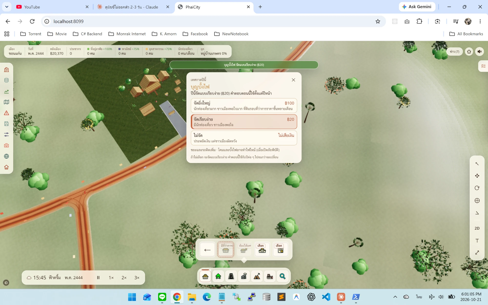
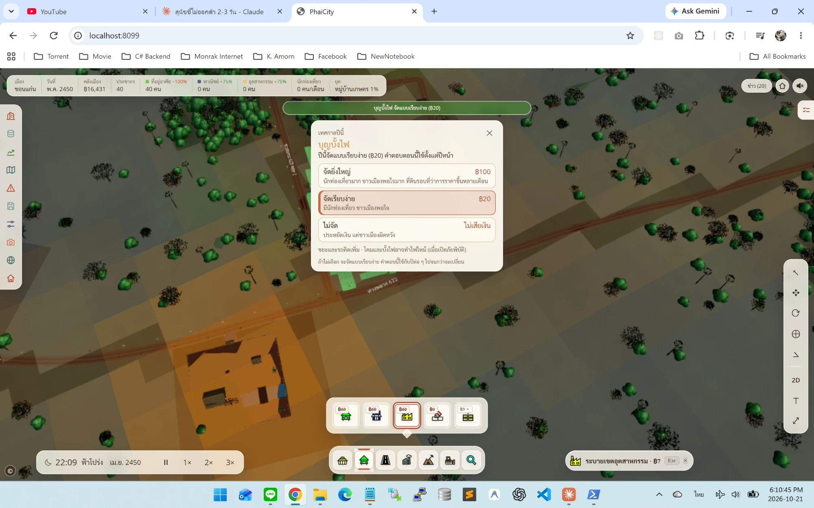
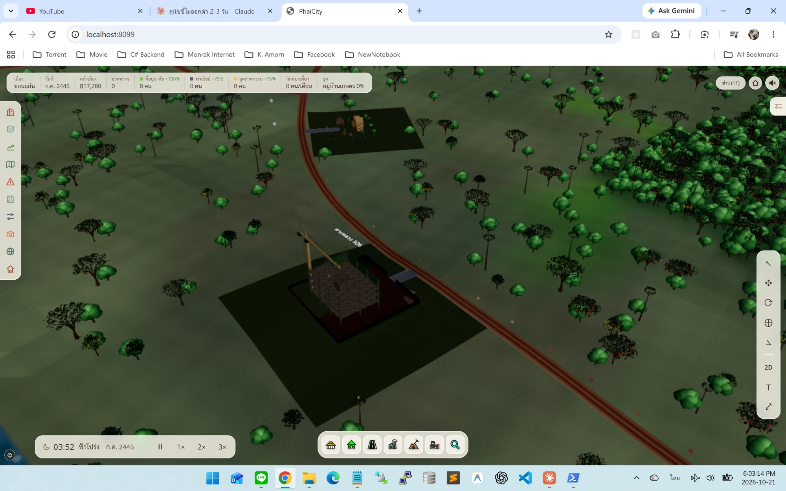
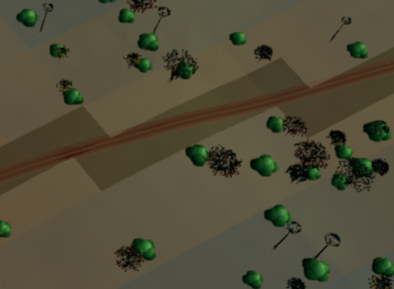
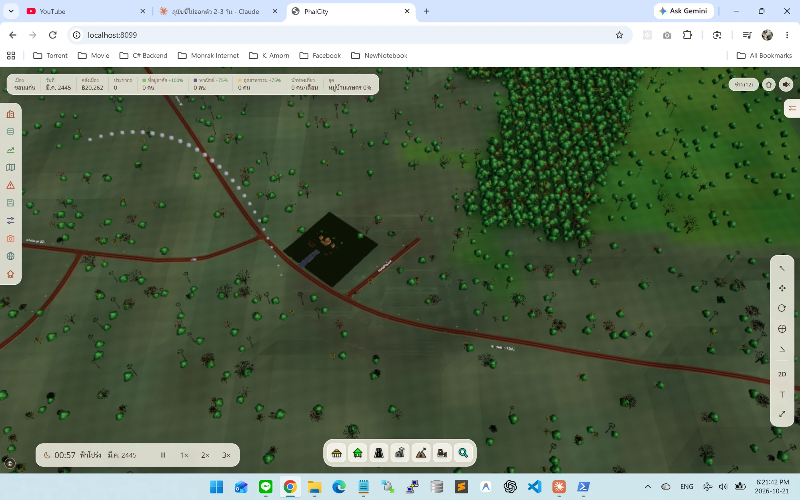

<!-- PhaiCity. A modified version of micropolisJS by Graeme McCutcheon, itself adapted from Micropolis.
     Released under the GNU GPL v3 with additional terms. See LICENSE and COPYING. -->

# สมุดภาพ: แบบนี้ใช่ แบบนี้ไม่ใช่

คำสั้น ๆ อย่าง "หน้าจอสะอาด" แต่ละคนเข้าใจไม่เหมือนกัน (เจ้านาย 21 ต.ค. 2026: "คำว่า design เป็นความสั้นๆ ก็ไม่ได้")
สมุดนี้จึงเก็บ **ภาพจริงที่เจ้านายติ** คู่กับ **ตัวเลขที่ตรวจได้** และ **ผู้เล่นควรรู้สึกยังไง**
ใครทำงานที่ผู้เล่นมองเห็น (ไผ่ทุกตัว) ต้องดูสมุดนี้ก่อนเริ่ม และตรวจงานกับมันก่อนรวมเข้า main
ทุกครั้งที่เจ้านายส่งภาพมาติ ไม้ไผ่พ่อเพิ่มลงที่นี่

## ✅ แบบที่ใช่

ภาพ concept ของเจ้านาย: `assets/concept/era{1..5}_A_house.jpg`, `era{1..5}_B_town.jpg`, `era{1..5}_C_vehicles.jpg`
- เมืองเป็นพระเอก แสงอุ่น เงาม่วงอ่อน แบบโมเดลจิ๋ว
- ทุ่งนา สวน และบ้านแผ่รอบหมู่บ้าน
- ไม่มีป้าย แถบ หรือไอคอนลอยเกะกะ

## ❌ แบบที่ไม่ใช่ (21 ต.ค. 2026)

### การ์ดเด้งกลางจอตอนเริ่มเมือง

- เจ้านาย: "มันมีอะไรมารกหน้าจอมากๆ เลย"
- **ผู้เล่นควรรู้สึก:** เพิ่งเริ่มเมือง ยังไม่มีคน หน้าจอควรเงียบ มีแค่ถนน ทุ่ง และจวน กำลังจะสร้างอะไรบางอย่าง ไม่ใช่ถูกถามเรื่องเทศกาล
- **ตรวจได้:**
  - 10 นาทีแรกไม่มีอะไรเด้งขึ้นเองเลย
  - การ์ดทุกใบรออยู่หลังปุ่มเล็กที่ผู้เล่นกดเอง
  - แถบข่าวกับการ์ดเรื่องเดียวกันไม่ขึ้นพร้อมกัน

### การ์ดบังพื้นที่ที่วาดได้น้อยอยู่แล้ว

- เจ้านาย: "ไอ้หน้าเทศกาลต่างๆ ให้แสดงนานๆ ทีสิ นี่บ่อยเกิน ... พื้นที่วาดยิ่งน้อยๆ อยู่ ต้องมาคอยกดปิดอีก"
- **ตรวจได้:** เทศกาลเป็นงานจริงยุคละ 2–3 ครั้ง และไม่มีอะไรบังกลางจอขณะถือเครื่องมือ

### พื้นรอบอาคารกว้างเกินช่องที่มันกิน

- เจ้านาย: "พื้นที่รอบข้าง object มันเกินที่ๆ กำหนดหรือป่าว ต้องย่อให้เท่าๆ กับที่สร้างได้พอดี" และ "โรงไฟฟ้า ทำไมมีพื้นที่เยอะ"
- **ตรวจได้:**
  - พื้นของอาคาร = ช่องที่อาคารกินพอดี ไม่เกินแม้แต่เมตรเดียว
  - อาคารกินที่เท่าตัวโมเดลจริง (โรงไฟฟ้าและประปาก่อน)
  - หน้าอาคารชิดขอบถนน

### ที่ที่อาคารจองไว้แต่ดูว่างเปล่า
- เจ้านาย (21 ต.ค. 2026): จวนหมุนหันหน้าเข้าถนนเฉียง แต่ระบบยังจองบล็อก 3 × 3 ตั้งตรง มุมบล็อกยื่นออกนอกที่ดินที่วาด เป็นหญ้าเปล่าที่วางถนนไม่ได้ "ถ้าพื้นที่ที่กันไว้ ก็ควรจะมีพื้นที่กั้นไว้นะ"
- **ผู้เล่นควรรู้สึก:** มองแล้วรู้ทันทีว่าตรงไหนเป็นของอาคาร ตรงไหนยังว่าง ไม่มีช่องลับที่จู่ ๆ ก็ห้ามสร้าง
- **ตรวจได้:**
  - อาคารหมุนกินช่องตามรูปที่หมุน ไม่ใช่บล็อกตั้งตรง (`test/turnedFootprint.ts`)
  - ทุกอาคารของเจ้าเมืองมีรั้วเตี้ย แนวรั้ว หรือรั้วต้นไม้ตามขอบที่จอง ตามแบบของยุค มีช่องประตูด้านหน้า
  - ถนนที่วาดนอกรั้วนิดเดียววางได้ ถนนที่เข้าในรั้วจวนถูกปฏิเสธ

### พื้นขั้นบันไดตามถนนเฉียง และต้นไม้เป็นจุดดำ

- เจ้านาย: "ทำไมยังเห็นรอยเป็นช่องๆ อยู่ เราไม่ได้สร้างตามช่องแล้วไม่ใช่เหรอ?"
- **ตรวจได้:**
  - ไม่มีลายช่อง 16 ม. บนพื้นให้เห็นเลย
  - ตอนถือแปรงเห็นแค่เงาจางของแถบที่จะทา
  - ต้นไม้ทุกแบบเป็นต้นไม้ ไม่เป็นฝุ่นหรือรอยไหม้

### ของที่ค้างหลังเหตุการณ์จบ และฝนที่ตกบ่อยเกิน

- เจ้านาย: "ฝนตกบ่อยเกินไปมากๆ และไอ้ขาวๆ ลอยขึ้นมาคืออะไร" และ "ทุกอย่างมันเร็วไป ทั้งฝนตก เทศกาล เอาในแต่ละยุค มี 2-3 ครั้งกำลังดี"
- **ตรวจได้:**
  - ของประดับเทศกาลแสดงเฉพาะช่วงที่เทศกาลนั้นจัดจริง
  - ฝนบนจอยุคละ 2–3 ช่วง

## วิธีทดสอบให้เหมือนคนเล่น

เจ้านาย: "แกวางทุกตำแหน่งเป๊ะๆ กับคนวางจริง มันไม่เหมือนกัน"
- คลิกเยื้อง 5–20 พิกเซล ลากแบบมือสั่น ปล่อยเมาส์ห่างถนนครึ่งช่อง
- วัดว่าเกมทำตามที่ผู้เล่นตั้งใจได้กี่ครั้ง
- เกมต้องให้อภัย: ดูดเข้าถนน เดาเจตนาให้ถูก วางให้ได้ ไม่ปฏิเสธเพราะเยื้องไม่กี่พิกเซล
